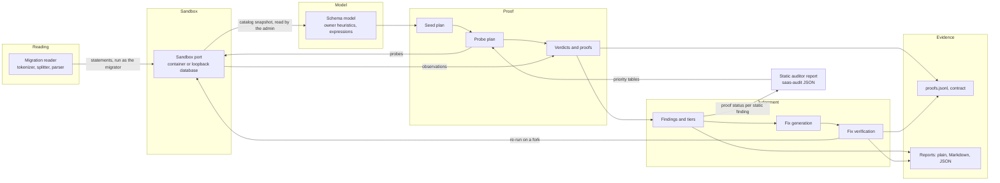

# Domain model

proof-audit has one job: turn the suspicion "this table's row level security might be wrong" into a record that anyone can replay, and show that a proposed fix closes the hole without breaking the app. This page defines the words used in the code, the docs and the reports, and how the parts relate.

## Glossary

| Term | Meaning |
| --- | --- |
| **Migration** | A plain SQL file the user supplies. The tool never reads a live system, an `.env` file or a secret. |
| **Sandbox** | A throwaway PostgreSQL database the tool creates for one run: either inside a container with no network, or inside a database on the loopback interface of this machine. It is destroyed afterwards. |
| **Admin, migrator, prober** | The three database roles of the sandbox. The *admin* is a superuser that only runs statements written by the tool. The *migrator* is what Supabase calls `postgres`: it applies the migrations, seeds and fixes without superuser rights. The *prober* only switches to `anon` and `authenticated` to run probes. |
| **Platform fingerprint** | The `auth.*` functions (owner and body hash), roles, memberships, settings, event triggers and platform schemas, read before the migrations, after them, after the probes and after the fix probes. A difference is an integrity violation. |
| **Integrity violation** | A migration touched, or tried to touch, the test environment the verdicts depend on (redefining `auth.*`, event triggers, `ALTER DATABASE/ROLE ... SET search_path`, catalog writes, the tool's own schema) or a fingerprint changed. The run is `INTEGRITY_VIOLATION` (exit code 4): every finding is INCONCLUSIVE and no fix is proposed. |
| **Platform / shim** | The part of a Supabase project that row level security depends on, rebuilt in the sandbox by the admin: the roles `anon`, `authenticated` and `service_role`, `auth.users`, `auth.uid()`/`role()`/`jwt()`/`email()` reading `request.jwt.claims`, and Supabase's default privileges. |
| **Schema model** | Tables, columns, policies, privileges and views as the sandbox reports them (the *catalog model*), or as the SQL reader understood them from the migration text (the *parsed model*). |
| **Owner column** | The column that says whose row it is: `user_id`, `owner_id`, `created_by`, `tenant_id`, `org_id`, a column referencing `auth.users`, a column defaulting to `auth.uid()`. Detected by explainable heuristics; the first user-kind column with at least medium confidence is the *primary owner column*. |
| **Synthetic identity** | User A (`alice@example.test`), user B (`bob@example.test`) and the anonymous caller. Fixed values, never real data. |
| **Seed** | One row per synthetic user in every table (one shared row where there is no owner column), built from column types and `CHECK` constraints. A table that cannot be seeded is recorded, never guessed. |
| **Probe** | One SQL statement run as a role with given JWT claims inside a transaction that is always rolled back. Exploit probes try what an attacker would try; legitimate probes try what the app itself must still be able to do. |
| **Proof** | The record of one probe: id, table, command, role and claims, the exact SQL, what the database returned, a verdict, a reason and a content hash. |
| **Verdict** | `PROVEN_VULNERABLE` (the attack worked), `NOT_REPRODUCED` (the database refused it), `INCONCLUSIVE` (no clear answer, with the reason); for legitimate probes `ACCESS_OK` and `ACCESS_BROKEN`. |
| **Evidence tier** | Per table or view: `PROVEN` (a probe reproduced the problem), `SUSPECTED` (a static pattern only, not reproduced, low confidence), `CLEAN` (every attack was refused), `INCONCLUSIVE` (some attacks could not be run and nothing suggests a problem). |
| **Finding** | The tier of one table or view with the one-sentence "what an attacker could do", the static causes, and the fix status. |
| **Cause** | A static reason that explains a proof (policy with an always-true condition, row level security off, a policy that compares the wrong column). A cause alone never makes a finding PROVEN. |
| **Fix** | SQL derived from the model: enable RLS, owner-scoped policies written with `(select auth.uid())`, revoke anon privileges, `security_invoker` views. Always a starting point. |
| **Verification** | The same probes re-run on a fresh copy of the sandbox with the fix applied. A fix is `VERIFIED` only if every previously proven probe is now refused **and** every legitimate probe that worked before still works. |
| **Evidence file** | `proofs.jsonl`: one metadata line, then one line per proof. `proof-audit verify` regenerates the probes and the fix and replays them; the file's SQL is never executed. |
| **Verification contract** | `verification-contract.json`: checks of the form `{command, expectedExitCode}` that an orchestrator can run to require evidence before a task counts as done. |

## Context map

Relationships between the contexts:

- **Reading to Sandbox** is *conformist*: the migration text is applied statement by statement and every rejected statement is recorded. The SQL reader exists for statement splitting, the static view and warnings; the sandbox decides what the schema really is.
- **Sandbox to Model** is an *anti-corruption layer*: the database's JSON catalog snapshot is validated against a strict schema before the domain sees it.
- **Proof** only knows the model and the sandbox *port*. It has no idea whether the database is in a container or on loopback.
- **Static auditor** is *customer/supplier* in one direction only: its JSON report is read, never executed, and its findings are matched to the probes that are about them. Findings outside row level security are counted as out of scope.
- **Evidence** is a published language: both files carry hashes so a replay can tell a changed input from a changed behaviour.

## Layers

`src/domain` (pure) &lt;- `src/application` (use cases and ports) &lt;- `src/infrastructure` (docker, Postgres, files, CLI) &lt;- `src/composition` (wiring). The rule is enforced by `test/architecture/layers.test.ts`. See [ADR 0002](adr/0002-layers-and-the-dependency-rule.md).
